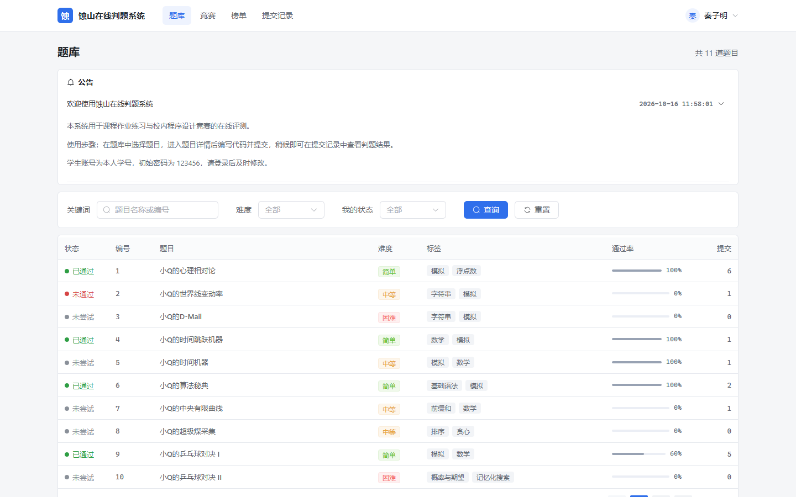
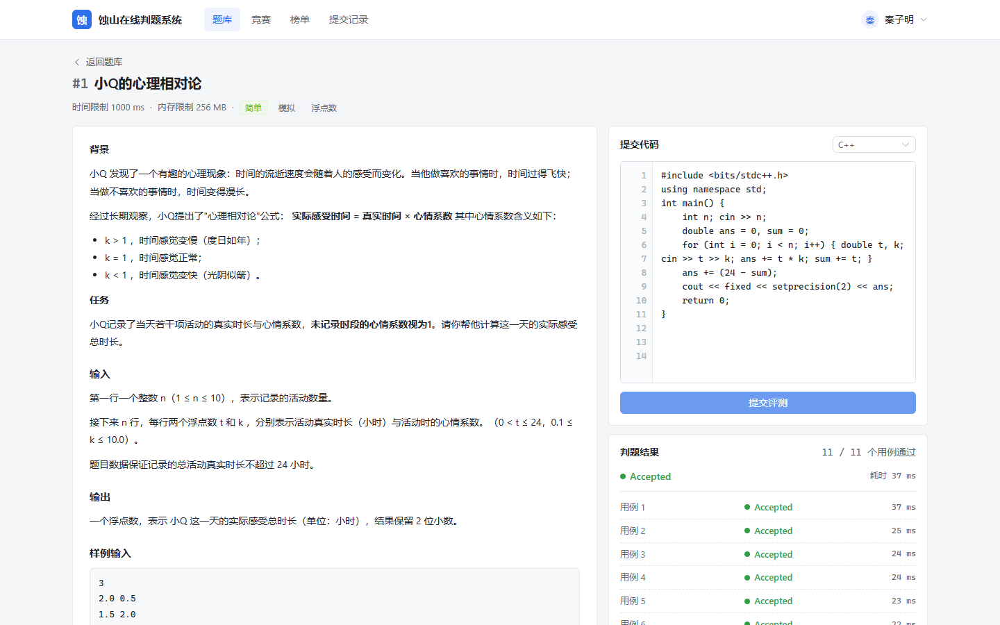
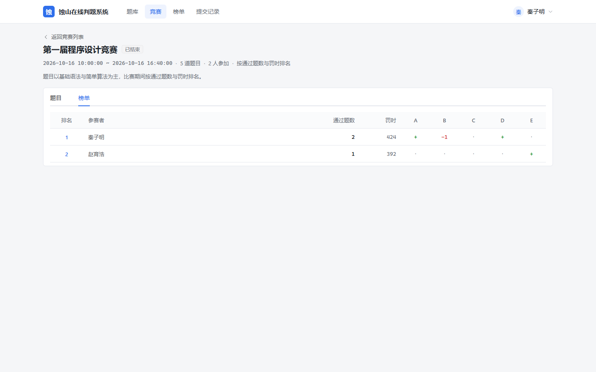

# 蚀山在线判题系统（SSoj）

基于 Spring Boot 与 Vue 3 的教学型在线判题系统，支持题库练习、在线评测、竞赛与榜单，配套管理后台。课程设计项目，小组名称为 **蚀山制造**。



## 功能

- **题库**：按关键词、难度、我的做题状态筛选，Markdown 题面渲染，算法标签检索
- **在线评测**：支持 C / C++ / Java，提交后异步判题，逐用例返回状态与耗时，编译错误展示编译器原始信息
- **竞赛**：A / B / C 编号编排，按通过题数与罚时排名；可开启赛题隐藏，比赛结束前赛题不出现在题库，赛后自动回到题库
- **榜单与统计**：总榜、个人统计、管理端运行概览
- **管理后台**：题目与测试用例、竞赛编排、用户与密码、公告与系统配置

| 题目详情与判题结果 | 竞赛榜单 |
| --- | --- |
|  |  |

## 技术栈

| 层次 | 技术 |
| --- | --- |
| 后端 | JDK 21、Spring Boot 4.1、MyBatis-Plus 3.5、Maven |
| 数据库 | MySQL 8.0 |
| 前端 | Vue 3、Vite、Element Plus、Vue Router、Axios |
| 鉴权 | JWT + 拦截器 + 权限注解 |
| 判题 | 固定线程池 + 有界队列，`ProcessBuilder` 调用 gcc / g++ / javac 编译运行 |

## 目录结构

```
├── src/main/java/com/ss/ssoj/
│   ├── auth/             登录拦截器、JWT 与权限注解
│   ├── common/           统一响应、异常处理与状态码
│   ├── config/           MyBatis-Plus 与判题参数配置
│   ├── controller/       接口层
│   ├── dto/ vo/          请求与响应模型
│   ├── entity/ mapper/   数据模型与持久层
│   ├── runner/           启动时恢复未完成的判题任务
│   └── service/          业务逻辑
├── src/main/resources/
│   ├── application.properties   数据源、判题语言与令牌配置
│   └── mapper/                  统计类自定义 SQL
├── sql/                  数据库脚本
├── web/                  前端工程
└── docs/screenshots/     界面截图
```

## 环境要求

| 依赖 | 版本 | 用途 |
| --- | --- | --- |
| JDK | 21 | 运行后端服务 |
| Maven | 3.8 及以上 | 后端依赖管理与打包 |
| MySQL | 8.0 | 业务数据存储 |
| Node.js | 18 及以上（推荐 20+） | 前端构建与开发服务器 |
| g++ / gcc | 支持 C++14 | 判题时编译 C 与 C++ 程序 |

Windows 下可直接使用 MinGW 提供的 gcc / g++，并确保 `g++`、`java`、`javac` 已加入系统环境变量 `PATH`。

### 判题工具链（每台机器都要装）

判题会在本机调用 `gcc`、`g++`、`javac`、`java`，这些程序不随项目分发：

- **JDK 21**：必须是 JDK（带 `javac`），只装 JRE 不行
- **MinGW-w64 8.1**（x86_64、posix-seh）：统一解压到 **`C:\mingw64`**，并把 **`C:\mingw64\bin`** 加入系统 PATH

```cmd
where g++
where javac
```

两条都能输出路径才算配置正确。**改完 PATH 后必须完全退出 IDEA 再启动**，否则后端进程读到的仍是旧环境，会报 `Cannot run program "g++" ... CreateProcess error=2`。

安装在其它目录也可以：把实际的 `bin` 目录加进 PATH，或者直接用下面的配置项。

更省事的做法是不动系统 PATH，直接在 `src/main/resources/application.properties` 里分别指定各语言的 bin 目录：

```properties
judge.languages.c.bin-dir=C:/mingw64/bin
judge.languages.cpp.bin-dir=C:/mingw64/bin
judge.languages.java.bin-dir=C:/Program Files/Java/jdk-21/bin
```

判题会在该目录下查找 `gcc` / `g++` / `javac` / `java`，路径带空格也没问题；留空或找不到时回退到系统 PATH。详细说明见 [docs/判题环境配置.md](docs/判题环境配置.md)。

## 快速开始

### 1. 初始化数据库

在 `sql` 目录下按顺序执行：

```bash
mysql -u root -p --default-character-set=utf8mb4 < sql/01_schema.sql
mysql -u root -p --default-character-set=utf8mb4 < sql/02_init_data.sql
mysql -u root -p --default-character-set=utf8mb4 < sql/03_problem_data.sql
```

`01_schema.sql` 建库建表，`02_init_data.sql` 写入账号、系统配置与公告，`03_problem_data.sql` 写入题目、测试用例、演示竞赛与演示提交记录（含判题结果，可直接看到榜单与提交历史）；`00_reset.sql` 用于开发阶段重建表结构。数据库连接信息在 `src/main/resources/application.properties` 中配置，克隆后请改成自己的账号密码。

### 2. 启动后端

```bash
mvn spring-boot:run
```

也可以在 IDEA 中直接运行 `SSojApplication`。启动成功后监听 `http://localhost:8080`，接口统一前缀 `/api`。

### 3. 启动前端

```bash
cd web
npm install
npm run dev
```

浏览器访问 `http://localhost:5173`，开发服务器已把 `/api` 代理到后端 8080 端口。

## 默认账号

| 角色 | 用户名 | 密码 |
| --- | --- | --- |
| 管理员 | ztw666 | 123456 |
| 学生 | 本人学号 | 123456 |

按课程演示要求，密码在数据库中明文保存，账号仅用于本地演示，请勿复用真实密码。

## 判题说明

- 支持语言：C（gcc）、C++（g++）、Java（javac / java）；语言与编译运行命令集中在 `application.properties` 的 `judge.languages.*`，新增语言不需要改判题代码
- 判题流程：提交入库后进入判题队列，依次完成编译、逐用例运行、结果比对与结果回写，页面轮询展示判题进度
- 资源限制：按题目时间限制计时，超时强制结束进程；输出超过上限（默认 16 MB）判为运行错误
- 结果比对：忽略每行行末空白与文末换行
- 服务重启后，处于待判题与判题中状态的提交会自动重新入队
- 目前不支持特殊判题（SPJ）与浮点误差比对

> 需求规格说明书、操作说明与答辩 PPT 随课程设计一并提交，本仓库只包含工程源码、数据库脚本与界面截图。

## 已知限制

- 判题在宿主机直接执行编译运行命令，没有容器沙箱，不限制内存占用，仅用于校内教学演示
- 不支持特殊判题与浮点误差比对，需要容差判定的题目要保证标准答案唯一
- 判题进度使用前端轮询实现，尚未接入 WebSocket 推送
